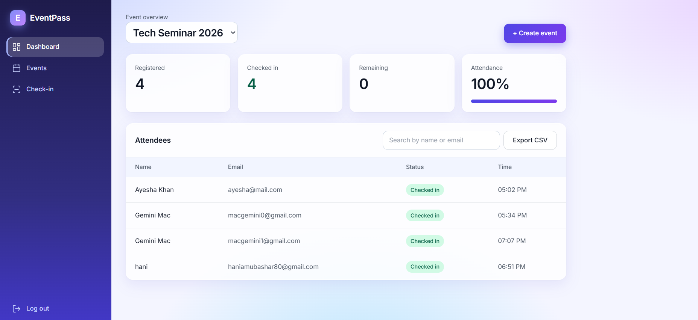
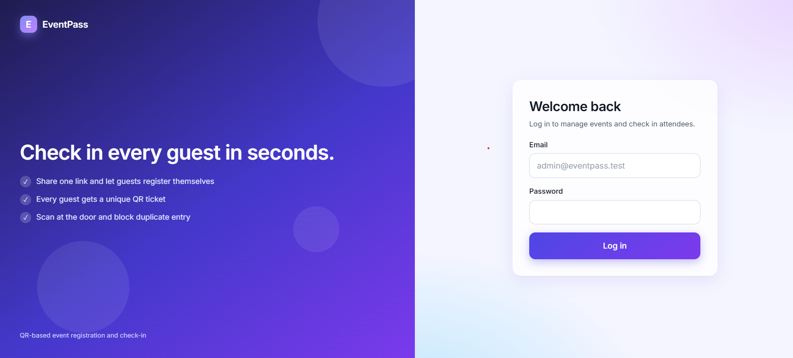

# EventPass

QR-based event registration and check-in system.

Organizers create events and share a public registration link. Attendees
register themselves and receive a unique QR ticket. Staff scan tickets at
the door and duplicate entry is blocked.

## Features
- Admin login (Laravel Sanctum token auth)
- Event CRUD with auto-generated public link and optional seat limit
- Public registration with duplicate-email and capacity checks
- Unique QR ticket per attendee, downloadable as an image
- Camera QR scanner with manual-code and photo-scan fallbacks
- Check-in results: success, already used, invalid
- Live dashboard: registered, checked in, remaining, attendance %
- Attendee search and CSV export
- Responsive UI (desktop sidebar, mobile tab bar)

## Tech stack
React (Vite), React Router, Axios, plain CSS, Laravel (REST API),
Sanctum, MySQL

## Setup

### Backend
    cd backend
    composer install
    copy .env.example .env
    php artisan key:generate
    (set DB_* values in .env)
    php artisan migrate --seed
    php artisan serve

### Frontend
    cd frontend
    npm install
    copy .env.example .env
    npm run dev

## Screenshots

